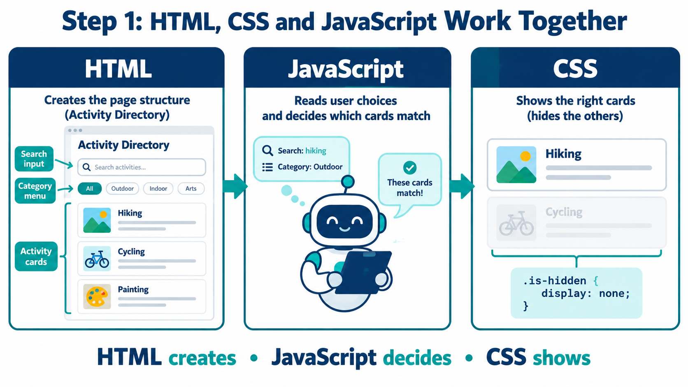
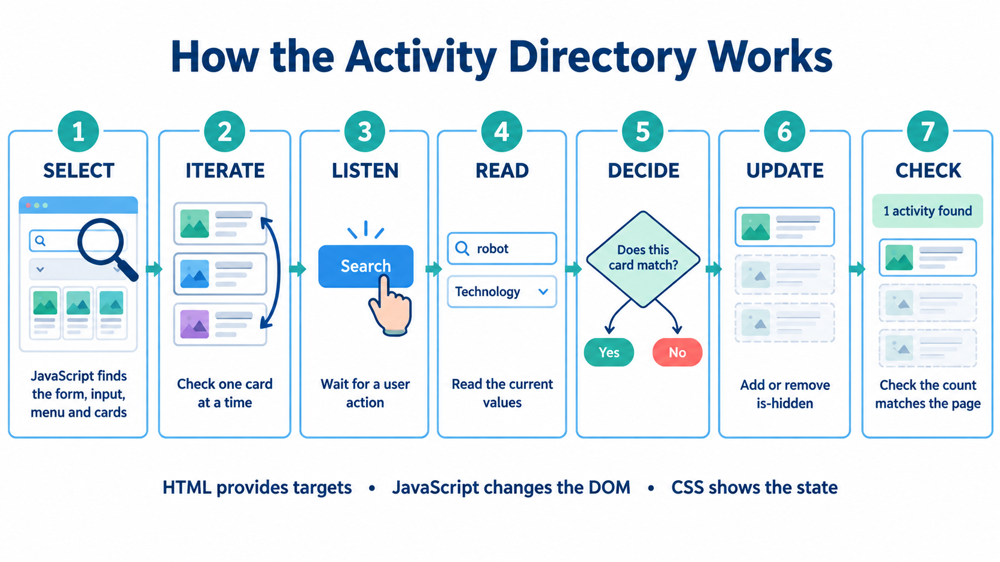
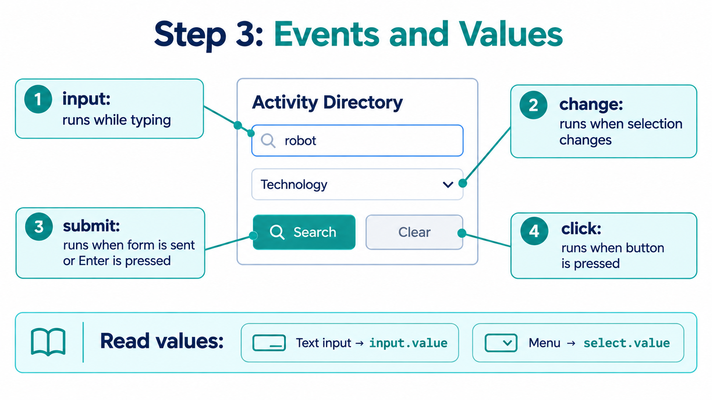

# Activity Directory

A complete beginner project for learning how webpages become interactive.

This project uses:

- **HTML** to create webpage content.
- **CSS** to control the appearance of content.
- **JavaScript** to respond when the user does something.

Read each explanation before copying the code. Complete one step, check it works, then move to the next step.

---

## What You Will Build

You will build an **Activity Directory**: a webpage that displays activities such as Basketball Club, Coding Workshop, and Robotics Challenge.

The user will be able to:

1. Type a search word, such as `robot`.
2. Choose a category, such as `Technology`.
3. Click **Search**.
4. See only activity cards that match both choices.
5. Click **Clear** to reset the search and show all activities.

For example:

| User choice | Result |
|---|---|
| Search word: `coding` | Only Coding Workshop appears |
| Category: `Sports` | Only sports activities appear |
| Search word: `robot` and category: `Technology` | Only Robotics Challenge appears |
| Click Clear | All activities appear again |

---

## What You Will Learn

By the end of this project, you should be able to:

- Explain the different jobs of HTML, CSS, and JavaScript.
- Understand the DOM in simple terms.
- Find HTML elements in JavaScript.
- Use `querySelector()` and `querySelectorAll()`.
- Understand the difference between one element and many elements.
- Use `forEach()` to process one card at a time.
- Use events such as `submit`, `change`, and `click`.
- Read values from text inputs and dropdown menus.
- Make decisions with true/false values.
- Add and remove CSS classes.
- Update visible text using `textContent`.
- Test and debug a simple webpage.

---

# Part 1: Understand Before Building

Do not create files yet. Start by understanding how the three web technologies work together.

---

## HTML, CSS, and JavaScript

A webpage normally uses HTML, CSS, and JavaScript together.



| Language | Simple job | In this project |
|---|---|---|
| HTML | Creates the content | Creates the form, buttons, status message, and activity cards |
| CSS | Controls how content looks | Adds layout, spacing, colours, and hides cards |
| JavaScript | Makes the page respond | Reads user choices and filters activity cards |

Use this sentence to remember their roles:

> **HTML creates. CSS styles. JavaScript responds.**

---

## HTML: Creates the Page

**HTML** is used to create the pieces of a webpage.

In this project, HTML creates:

- The title: `Activity Directory`.
- A search input where a user can type.
- A category dropdown menu.
- A Search button.
- A Clear button.
- A message that reports the number of visible activities.
- Six activity cards.

Here is an HTML input:

```html
<input id="keyword" type="text">
```

This creates a box where a user can type text.

The `id` is a unique name for that element:

```text
keyword
```

JavaScript will use that name to find the input later.

Here is one HTML activity card:

```html
<article class="activity-card sports">
  <h2>Basketball Club</h2>
  <p>Play weekly basketball games with other students.</p>
</article>
```

| Part | Meaning |
|---|---|
| `<article>` | A separate piece of related content |
| `activity-card` | A class showing that this is an activity card |
| `sports` | A class showing that this card is in the Sports category |
| `<h2>` | A heading |
| `<p>` | A paragraph |

> **Key idea:** HTML creates the page content and gives JavaScript elements to find.

---

## CSS: Styles the Page

**CSS** controls the appearance of HTML elements.

In this project, CSS controls:

- The page background colour.
- The font.
- Spacing between elements.
- The layout of activity cards.
- The look of form controls.
- Whether a card is visible or hidden.

Here is CSS that styles activity cards:

```css
.activity-card {
  padding: 16px;
  background: white;
  border-left: 5px solid #2563eb;
}
```

The most important CSS rule in this project is:

```css
.is-hidden {
  display: none;
}
```

`display: none` means:

> Do not display this element on the webpage.

This card is visible:

```html
<article class="activity-card sports">
```

This card is hidden:

```html
<article class="activity-card sports is-hidden">
```

> **Key idea:** CSS controls what the user sees.

---

## JavaScript: Adds Behaviour

**JavaScript** makes the webpage react to user actions.

In this project, JavaScript will:

1. Find the form, input, dropdown, buttons, status message, and activity cards.
2. Wait for the user to search, choose a category, or clear filters.
3. Read the user’s choices.
4. Check each activity card.
5. Decide whether each card should show.
6. Add or remove the `is-hidden` CSS class.
7. Update the status message.

Example:

```js
const keywordInput = document.querySelector("#keyword");
```

This means:

> Find the HTML element whose id is `keyword`.

Example:

```js
clearButton.addEventListener("click", function () {
  keywordInput.value = "";
});
```

This means:

> When the Clear button is clicked, remove the text from the search input.

Example:

```js
card.classList.toggle("is-hidden", !shouldShow);
```

This means:

> Add `is-hidden` if the card should not show. Remove it if the card should show.

> **Key idea:** JavaScript listens, reads, decides, and updates.

---

## How the Files Work Together

Imagine the user types `robot`, chooses Technology, and clicks Search.

| Order | Which technology? | What happens? |
|---|---|---|
| 1 | HTML | Provides the search input, dropdown, button, and cards |
| 2 | JavaScript | Reads the word `robot` |
| 3 | JavaScript | Reads the category `technology` |
| 4 | JavaScript | Checks each activity card |
| 5 | JavaScript | Decides whether the card matches both choices |
| 6 | JavaScript | Adds `is-hidden` to cards that do not match |
| 7 | CSS | Hides cards with the `is-hidden` class |
| 8 | JavaScript | Updates the status message |

---

## The Interaction Cycle

When a user interacts with the Activity Directory, JavaScript follows the same order.



1. **Select** — Find the HTML elements.
2. **Iterate** — Work through the activity cards one at a time.
3. **Listen** — Wait for the user to do something.
4. **Read** — Read the current values from the form.
5. **Decide** — Decide whether a card should appear.
6. **Update** — Change CSS classes and visible text.
7. **Check** — Confirm the page shows the correct result.

If something does not work, check these steps in the same order.

> The first step that does not work is usually the place to start debugging.

---

## The DOM

The **DOM** means **Document Object Model**.

A simple definition is:

> The DOM is the browser’s live version of the HTML page.

HTML is the code you write in `index.html`.

The browser reads that HTML and creates a live page structure in memory. JavaScript uses the DOM to find and change that live structure.

For example:

```html
<input id="keyword" type="text">
```

JavaScript can find that element in the DOM:

```js
document.querySelector("#keyword");
```

Then JavaScript can read what the user typed:

```js
keywordInput.value
```

---

## Find HTML Elements

Before JavaScript can use an HTML element, it must find it.


Use `querySelector()` to find **one** element.

```js
const keywordInput = document.querySelector("#keyword");
```

Use `querySelectorAll()` to find **many** elements.

```js
const cards = document.querySelectorAll(".activity-card");
```

| HTML name | Selector used in JavaScript | Meaning |
|---|---|---|
| `id="keyword"` | `"#keyword"` | Find one element with this id |
| `id="status"` | `"#status"` | Find one element with this id |
| `class="activity-card"` | `".activity-card"` | Find every element with this class |

### One Element

```js
const status = document.querySelector("#status");
```

This result will be:

- One HTML element if JavaScript finds it.
- `null` if JavaScript cannot find it.

### Many Elements

```js
const cards = document.querySelectorAll(".activity-card");
```

This returns a collection called a **NodeList**.

A NodeList can contain:

- No cards.
- One card.
- Many cards.

Check how many cards JavaScript found:

```js
console.log(cards.length);
```

Use `forEach()` to work with one card at a time:

```js
cards.forEach(function (card) {
  console.log(card.textContent);
});
```

---

## Events and Values

An **event** is something the user does on the webpage.



| User action | Event name | When it happens |
|---|---|---|
| User types in an input | `input` | Every time the text changes |
| User chooses a category | `change` | When the dropdown value changes |
| User clicks Search or presses Enter | `submit` | When the form is submitted |
| User clicks Clear | `click` | When the Clear button is clicked |
| User presses a keyboard key | `keydown` | When a key is pressed |

Read text from the search input:

```js
const query = keywordInput.value.trim();
```

Read the chosen category:

```js
const category = categorySelect.value;
```

| HTML element | Property to read | Example result |
|---|---|---|
| Text input | `.value` | `"robot"` |
| Dropdown menu | `.value` | `"technology"` |
| Ordinary element | `.textContent` | `"6 activities found"` |
| Checkbox | `.checked` | `true` or `false` |

`.trim()` removes extra spaces before and after text.

```text
"   robot   "
```

becomes:

```text
"robot"
```

---

## Check Understanding

Before starting the practical, explain these ideas aloud or write short answers:

1. What does HTML create?
2. What does CSS control?
3. What does JavaScript do after a user clicks Search?
4. What is the DOM?
5. Why must JavaScript select an element before it can use it?
6. What is the difference between `querySelector()` and `querySelectorAll()`?
7. What does the `is-hidden` class do?
8. Which event is used for the Clear button?

---

# Part 2: Build the Project

Follow every step in order. Do not skip a check.

---

## Step 1: Create the Project Folder

Create a new folder on your computer.

Name it:

```text
activity-directory
```

Inside this folder, create four files:

```text
index.html
style.css
app.js
README.md
```

Also create a folder called:

```text
pics
```

Your folder should look like this:

```text
activity-directory/
├── index.html
├── style.css
├── app.js
├── README.md
└── pics/
    ├── dom-steps.png
    ├── html-css-js.png
    ├── selectors.png
    └── events-values.png
```

### Check Before Continuing

Make sure:

- The folder is named `activity-directory`.
- The file is named `index.html`, not `index.html.txt`.
- The file is named `style.css`, not `style.css.txt`.
- The file is named `app.js`, not `app.js.txt`.
- All four images are inside `pics`.

---

## Step 2: Create the HTML Page

Open `index.html`.

Copy all of this code into the file:

```html
<!DOCTYPE html>
<html lang="en">
<head>
  <meta charset="UTF-8">
  <meta name="viewport" content="width=device-width, initial-scale=1.0">
  <title>Activity Directory</title>

  <link rel="stylesheet" href="style.css">
  <script src="app.js" defer></script>
</head>

<body>
  <main class="container">
    <h1>Activity Directory</h1>

    <form id="search-form">
      <label for="keyword">Search activities</label>

      <input
        id="keyword"
        type="text"
        placeholder="Try: coding"
      >

      <label for="category">Choose a category</label>

      <select id="category">
        <option value="all">All categories</option>
        <option value="sports">Sports</option>
        <option value="technology">Technology</option>
        <option value="arts">Arts</option>
      </select>

      <button type="submit">Search</button>
      <button type="button" id="clear-button">Clear</button>
    </form>

    <p id="status">6 activities found</p>

    <section class="activity-list">
      <article class="activity-card sports">
        <h2>Basketball Club</h2>
        <p>Play weekly basketball games with other students.</p>
      </article>

      <article class="activity-card technology">
        <h2>Coding Workshop</h2>
        <p>Learn JavaScript and create simple web applications.</p>
      </article>

      <article class="activity-card arts">
        <h2>Digital Drawing</h2>
        <p>Create illustrations using digital design tools.</p>
      </article>

      <article class="activity-card sports">
        <h2>Badminton Training</h2>
        <p>Improve your badminton skills and fitness.</p>
      </article>

      <article class="activity-card technology">
        <h2>Robotics Challenge</h2>
        <p>Build and program a small robot with your team.</p>
      </article>

      <article class="activity-card arts">
        <h2>Photography Walk</h2>
        <p>Practise taking photos around the campus.</p>
      </article>
    </section>
  </main>
</body>
</html>
```

Save the file.

---

## Step 3: Open the HTML Page

Find `index.html` in your `activity-directory` folder.

Open it in a web browser.

You should see:

- The heading **Activity Directory**.
- A search input.
- A category dropdown.
- A Search button.
- A Clear button.
- Six activity descriptions.

The page will look plain at this stage. That is expected because CSS has not been added yet.

### Check Before Continuing

Count the activity cards.

You should see exactly six:

1. Basketball Club
2. Coding Workshop
3. Digital Drawing
4. Badminton Training
5. Robotics Challenge
6. Photography Walk

---

## Step 4: Add the CSS

Open `style.css`.

Copy all of this code into the file:

```css
body {
  margin: 0;
  font-family: Arial, sans-serif;
  background: #f4f6f8;
  color: #1f2933;
}

.container {
  width: 90%;
  max-width: 900px;
  margin: 40px auto;
}

form {
  display: grid;
  gap: 10px;
  padding: 20px;
  background: white;
}

input,
select,
button {
  padding: 10px;
  font-size: 16px;
}

.activity-list {
  display: grid;
  grid-template-columns: repeat(auto-fit, minmax(220px, 1fr));
  gap: 16px;
  margin-top: 20px;
}

.activity-card {
  padding: 16px;
  background: white;
  border-left: 5px solid #2563eb;
}

.is-hidden {
  display: none;
}
```

Save `style.css`.

Return to the browser and refresh the page.

### Check Before Continuing

You should now see:

- A light grey page background.
- White areas around the form and cards.
- Blue lines on the left side of cards.
- Cards arranged in rows where the browser has enough space.

If the page still looks plain, check this line in `index.html`:

```html
<link rel="stylesheet" href="style.css">
```

Make sure `style.css` is in the same folder as `index.html`.

---

## Step 5: Understand `defer`

In `index.html`, this line connects JavaScript to the webpage:

```html
<script src="app.js" defer></script>
```

`src="app.js"` means:

> Use the JavaScript file named `app.js`.

`defer` means:

> Wait until the browser has read the HTML before running JavaScript.

This matters because JavaScript cannot find elements that the browser has not created yet.

Do not remove `defer`.

---

## Step 6: Select Elements with JavaScript

Open `app.js`.

Copy this code into the file:

```js
const form = document.querySelector("#search-form");
const keywordInput = document.querySelector("#keyword");
const categorySelect = document.querySelector("#category");
const clearButton = document.querySelector("#clear-button");
const status = document.querySelector("#status");

const cards = document.querySelectorAll(".activity-card");
```

Save `app.js`.

At this stage, the page will look the same. The JavaScript has found elements, but it has not told them to do anything yet.

---

## Step 7: Check That JavaScript Found the Elements

Add this temporary code at the bottom of `app.js`:

```js
console.log(form);
console.log(keywordInput);
console.log(categorySelect);
console.log(clearButton);
console.log(status);
console.log(cards.length);
```

Save the file.

Refresh the browser.

Open the browser Console:

1. Press `F12`.
2. Find and select **Console**.
3. Look at the messages.

You should see:

- Five HTML elements.
- The number `6`.

If you see `null`, check that the HTML id and JavaScript selector match exactly.

For example:

```html
<input id="keyword">
```

must match:

```js
document.querySelector("#keyword");
```

After checking, delete the temporary `console.log()` lines.

Your `app.js` should return to:

```js
const form = document.querySelector("#search-form");
const keywordInput = document.querySelector("#keyword");
const categorySelect = document.querySelector("#category");
const clearButton = document.querySelector("#clear-button");
const status = document.querySelector("#status");

const cards = document.querySelectorAll(".activity-card");
```

---

## Step 8: Create the Filter Function

Add this code below the selector code in `app.js`:

```js
function filterActivities(query, category) {
  let visibleCount = 0;

  cards.forEach(function (card) {
    const cardText = card.textContent.toLowerCase();

    const matchesKeyword = cardText.includes(query.toLowerCase());

    const matchesCategory =
      category === "all" || card.classList.contains(category);

    const shouldShow = matchesKeyword && matchesCategory;

    card.classList.toggle("is-hidden", !shouldShow);

    if (shouldShow) {
      visibleCount = visibleCount + 1;
    }
  });

  status.textContent = visibleCount + " activities found";
}
```

Save the file.

The page still will not filter yet. The function has been created, but nothing calls it yet.

---

## Step 9: Understand the Filter Function

The function starts here:

```js
function filterActivities(query, category) {
```

It needs two values:

| Value | Meaning |
|---|---|
| `query` | The word typed by the user |
| `category` | The selected category |

Example:

```js
filterActivities("robot", "technology");
```

This means:

> Search for `robot` in Technology activities.

### Count Visible Cards

```js
let visibleCount = 0;
```

This starts a counter at zero.

When a card should show, the counter increases by one.

### Check One Card at a Time

```js
cards.forEach(function (card) {
```

This means:

> For every activity card, run the code inside the braces.

`card` represents the current activity card.

### Read the Text in a Card

```js
const cardText = card.textContent.toLowerCase();
```

This gets the text from the current card and changes it to lowercase.

For example:

```text
Robotics Challenge
```

becomes:

```text
robotics challenge
```

This helps the search work whether the user types `robot`, `Robot`, or `ROBOT`.

### Check the Search Word

```js
const matchesKeyword = cardText.includes(query.toLowerCase());
```

This asks:

> Does the card text contain the search word?

Example:

```js
"robotics challenge".includes("robot");
```

The result is `true`.

Example:

```js
"robotics challenge".includes("coding");
```

The result is `false`.

### Check the Category

```js
const matchesCategory =
  category === "all" || card.classList.contains(category);
```

The `||` symbol means **OR**.

The code means:

> The category matches if the user selected All categories OR if this card has the selected category class.

### Make the Final Decision

```js
const shouldShow = matchesKeyword && matchesCategory;
```

The `&&` symbol means **AND**.

A card should show only if:

- The keyword matches **AND**
- The category matches.

| Keyword matches? | Category matches? | Should show? |
|---|---|---|
| Yes | Yes | Yes |
| Yes | No | No |
| No | Yes | No |
| No | No | No |

### Hide or Show the Card

```js
card.classList.toggle("is-hidden", !shouldShow);
```

If `shouldShow` is true:

- JavaScript removes `is-hidden`.
- CSS shows the card.

If `shouldShow` is false:

- JavaScript adds `is-hidden`.
- CSS hides the card.

### Update the Status Message

```js
status.textContent = visibleCount + " activities found";
```

If two cards are visible, the page displays:

```text
2 activities found
```

---

## Step 10: Connect the Search Form

Add this below the filter function:

```js
form.addEventListener("submit", function (event) {
  event.preventDefault();

  const query = keywordInput.value.trim();
  const category = categorySelect.value;

  filterActivities(query, category);
});
```

Save `app.js`.

### Understand This Code

```js
form.addEventListener("submit", function (event) {
```

This means:

> Wait until the form is submitted.

A form can be submitted when the user:

- Clicks the Search button.
- Presses Enter in the search input.

```js
event.preventDefault();
```

This stops the browser from refreshing the page.

```js
const query = keywordInput.value.trim();
```

This reads what the user typed.

```js
const category = categorySelect.value;
```

This reads the chosen category.

```js
filterActivities(query, category);
```

This runs the filter function using the current choices.

### Check Before Continuing

In the browser:

1. Type `coding`.
2. Click Search.

You should see:

- Only Coding Workshop.
- The message `1 activities found`.

Then:

1. Delete the text.
2. Click Search.

You should see all six cards again.

---

## Step 11: Connect the Category Dropdown

Add this code below the form listener:

```js
categorySelect.addEventListener("change", function () {
  const query = keywordInput.value.trim();
  const category = categorySelect.value;

  filterActivities(query, category);
});
```

Save `app.js`.

This means:

> When the category changes, read both current values and filter again.

### Check Before Continuing

In the browser:

1. Make sure the search input is empty.
2. Choose **Sports** from the dropdown.

You should see:

- Basketball Club.
- Badminton Training.
- The message `2 activities found`.

Then choose **All categories**.

You should see all six cards again.

---

## Step 12: Connect the Clear Button

Add this code below the category listener:

```js
clearButton.addEventListener("click", function () {
  keywordInput.value = "";
  categorySelect.value = "all";

  filterActivities("", "all");
});
```

Save `app.js`.

This means:

1. Empty the search input.
2. Change the dropdown value to `all`.
3. Run the filter with no search word and All categories.

### Check Before Continuing

In the browser:

1. Type `robot`.
2. Choose Technology.
3. Click Search.
4. Confirm only Robotics Challenge is visible.
5. Click Clear.

You should see:

- An empty search input.
- All categories selected.
- All six cards visible.
- The message `6 activities found`.

---

## Step 13: Final `app.js`

Your completed `app.js` should now contain exactly this:

```js
const form = document.querySelector("#search-form");
const keywordInput = document.querySelector("#keyword");
const categorySelect = document.querySelector("#category");
const clearButton = document.querySelector("#clear-button");
const status = document.querySelector("#status");

const cards = document.querySelectorAll(".activity-card");

function filterActivities(query, category) {
  let visibleCount = 0;

  cards.forEach(function (card) {
    const cardText = card.textContent.toLowerCase();

    const matchesKeyword = cardText.includes(query.toLowerCase());

    const matchesCategory =
      category === "all" || card.classList.contains(category);

    const shouldShow = matchesKeyword && matchesCategory;

    card.classList.toggle("is-hidden", !shouldShow);

    if (shouldShow) {
      visibleCount = visibleCount + 1;
    }
  });

  status.textContent = visibleCount + " activities found";
}

form.addEventListener("submit", function (event) {
  event.preventDefault();

  const query = keywordInput.value.trim();
  const category = categorySelect.value;

  filterActivities(query, category);
});

categorySelect.addEventListener("change", function () {
  const query = keywordInput.value.trim();
  const category = categorySelect.value;

  filterActivities(query, category);
});

clearButton.addEventListener("click", function () {
  keywordInput.value = "";
  categorySelect.value = "all";

  filterActivities("", "all");
});
```

---

# Part 3: Test the Completed Project

Complete every test below.

| Test | What to do | Expected result |
|---|---|---|
| 1. Show all | Leave the input empty and choose All categories | All six cards show; message says `6 activities found` |
| 2. Keyword match | Search for `coding` | Only Coding Workshop shows; message says `1 activities found` |
| 3. No keyword match | Search for `swimming` | No cards show; message says `0 activities found` |
| 4. Category match | Choose Sports | Basketball Club and Badminton Training show; message says `2 activities found` |
| 5. Both filters | Search for `robot` and choose Technology | Only Robotics Challenge shows; message says `1 activities found` |
| 6. Clear reset | Click Clear after filtering | Input clears, All categories returns, all six cards show |

Do not move to optional challenges until every required test works.

---

# Part 4: Debugging Guide

If something does not work, do not guess. Check one stage at a time.

## 1. Select

Question:

> Did JavaScript find the element?

Temporarily add:

```js
console.log(keywordInput);
console.log(cards.length);
```

Expected:

- `keywordInput` is an HTML input element, not `null`.
- `cards.length` is `6`.

If an element is `null`:

- Check the HTML `id`.
- Check the JavaScript selector.
- Check spelling, hyphens, and capital letters.
- Confirm that `<script src="app.js" defer></script>` is in the HTML file.

---

## 2. Listen

Question:

> Does the event listener run?

Temporarily add this inside a listener:

```js
console.log("The form was submitted");
```

Example:

```js
form.addEventListener("submit", function (event) {
  event.preventDefault();

  console.log("The form was submitted");
});
```

Click Search and look in the Console.

If no message appears:

- Check that the selector for the form is correct.
- Check that the listener is written in `app.js`.
- Save the file.
- Refresh the browser.

---

## 3. Read

Question:

> Did JavaScript read the correct values?

Temporarily add:

```js
console.log(query);
console.log(category);
```

Try a search such as:

```text
robot
```

and select:

```text
Technology
```

The Console should show:

```text
robot
technology
```

---

## 4. Decide

Question:

> Did JavaScript make the correct true/false decision?

Temporarily add this inside `forEach()`:

```js
console.log(cardText);
console.log(matchesKeyword);
console.log(matchesCategory);
console.log(shouldShow);
```

For Robotics Challenge with `robot` and Technology, the final value should be:

```text
true
```

For Coding Workshop with `robot` and Technology, the final value should be:

```text
false
```

---

## 5. Update

Question:

> Did JavaScript add or remove the class?

Right-click a hidden card in the browser.

Choose **Inspect**.

Look for:

```html
is-hidden
```

A hidden card should include this class:

```html
<article class="activity-card technology is-hidden">
```

---

## 6. Check

Question:

> Does the status message match the visible cards?

Examples:

| Visible cards | Correct message |
|---|---|
| 0 cards | `0 activities found` |
| 1 card | `1 activities found` |
| 2 cards | `2 activities found` |
| 6 cards | `6 activities found` |

---

# Part 5: Optional Challenges

Only try these after the required project works.

---

## Challenge 1: Live Search

At the moment, the user must click Search.

Add this code at the bottom of `app.js` to filter while the user types:

```js
keywordInput.addEventListener("input", function () {
  const query = keywordInput.value.trim();
  const category = categorySelect.value;

  filterActivities(query, category);
});
```

Test it:

1. Click in the search input.
2. Type `robot` slowly.
3. Watch the cards change while you type.

---

## Challenge 2: Clear with Escape

Add this code at the bottom of `app.js`:

```js
document.addEventListener("keydown", function (event) {
  if (event.key === "Escape") {
    keywordInput.value = "";
    categorySelect.value = "all";

    filterActivities("", "all");
  }
});
```

Test it:

1. Filter the activities.
2. Press the Escape key.
3. Confirm that all filters reset.

---

## Challenge 3: Add a New Card with JavaScript

Try creating a new activity card with JavaScript.

Add this code temporarily to the bottom of `app.js`:

```js
const activityList = document.querySelector(".activity-list");

const newCard = document.createElement("article");

newCard.classList.add("activity-card");
newCard.classList.add("technology");

newCard.textContent = "Game Design Club";

activityList.append(newCard);
```

This code:

1. Finds the container for all cards.
2. Creates a new `article`.
3. Adds the same classes used by existing activity cards.
4. Adds text to the new card.
5. Adds the new card to the page.

Refresh the browser and look for the new card.

Note: This is only a learning example. The filter will not include this newly created card because the original `cards` NodeList was selected before the new card was added.

---

# Project Summary

You have used:

| Concept | Where it was used |
|---|---|
| HTML | Creating the form, inputs, buttons, status message, and cards |
| CSS | Styling the page and hiding cards with `is-hidden` |
| DOM | The live page structure JavaScript can read and change |
| `querySelector()` | Finding one element |
| `querySelectorAll()` | Finding all activity cards |
| NodeList | Storing the collection of selected cards |
| `forEach()` | Checking one card at a time |
| `submit` | Responding to Search and Enter |
| `change` | Responding to category selection |
| `click` | Responding to Clear |
| `.value` | Reading an input or dropdown |
| `.textContent` | Reading card text and updating the status message |
| `classList.toggle()` | Showing or hiding a card |
| `display: none` | Hiding a card with CSS |

> **Final reminder:** HTML creates the targets. JavaScript listens, reads, decides, and updates. CSS shows the final result.
